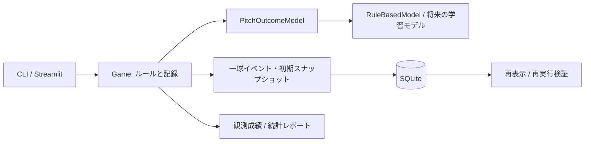

# アーキテクチャと今後のデータ

## 境界

確率モデルは `predict_probabilities(batter, pitcher, game_state, environment)` で5種類の投球結果の辞書を返し、`contact_probabilities(..., defense)` で9種類の打球結果を返します。キー、有限値、0〜1、総和1をエンジンで検証します。新しいモデルはこのProtocolと `metadata()` を実装します。合法でない状況の併殺・犠飛は確率0にする必要があり、違反はルールエンジンが例外にします。モデルは状態を書き換えず、予測だけを返す契約です。

ルールのテストは `apply_pitch` に結果を直接与えます。抽選する `step` と状態遷移を分けることで、四球・サヨナラ等の境界条件を確定的に検証できます。球種や打球物理を返す学習モデルは後からアダプターを追加します。LLMは公式記録を変更するAPIを持ちません。

`Player.latent` は安定した潜在特性、`ability` は現在の実力、`state` は疲労・健康・経験です。Phase 1ではlatentとabilityは初期値が同じで、その後の成長は行いません。投手の疲労は各球で更新し、試合後の状態を別途保持します。`recover` は休養のみを扱います。生成には共有因子を使い、球速と奪三振傾向、選球とコンタクト、年齢と成長余地を関連させています。いずれも仮定です。

## 再現性と記録

- Gameは入力球団をdeep copyし、実験元や過去の記録を変更しません。
- 抽選は試合ごとに1個のNumPy PCG64生成器を作り、グローバル乱数に依存しません。
- 初期スナップショットに全選手状態、打順・守備、先発、ルール・モデル・エンジン・NumPyの版、係数、シード、球場・天候を保存します。
- 公式game_idは初期スナップショットと交代履歴のハッシュ（交代がない場合は初期スナップショットのみ）。交代を行う進行中のIDは暫定で、完了時に確定します。イベントには連番、投球前後の状態、打者・投手、抽選結果と記録上の結果を保持します。交代は独立イベントで、実行前の総投球数も記録します。
- `replay` は保存入力から再生成し、交代を再適用して、一球ログ・最終状態・成績の全体一致を確認します。対応しない旧版のエンジン・モデル・NumPyでは明示的にエラーにします。将来版の実装を追加するときは旧版を残す必要があります。
- SQLiteの履歴テーブルはUPDATE/DELETE禁止トリガーで保護し、同じ入力に異なる結果を保存する操作も拒否します。アプリを経由しないファイルの改変まで防ぐ暗号的な監査基盤ではありません。
- 1試合をトランザクションで保存します。途中失敗では試合・イベント・個人成績をまとめてロールバックします。

## データベース

`teams` / `players` は公開プロフィール。`player_traits` / `player_states` は内部の実力・状態。`world` は再現用の初期世界です。`games` は初期スナップショットと最終記録、`game_events` は全投球・交代、`batting_statistics` / `pitching_statistics` は試合別記録、`game_lineups` は初期・最終打順と守備位置、`model_versions` はモデル版と設定です。

プロトタイプでは詳細をJSONに保持しています。PostgreSQLへ移行するときはStore境界を置き換え、検索頻度の高い項目を正規化できます。JSONはpickleなどの実行可能な形式ではありません。公開画面では初期スナップショットの潜在特性を表示せず、公開プロフィールと観測成績だけを渡します。

## Phase 2で取得するデータ

| 対象候補 | 主な用途 | 確認する点 |
|---|---|---|
| MLB Statcast / Baseball Savant | 球速・球種・カウント・投打・打球速度・角度・結果の条件付きモデル | 利用条件、取得期間、欠損、測定機器による差 |
| Retrosheetのイベント・ロスター | 走者進塁、アウト・得点、併殺・犠飛、イニング遷移の検証 | 帰属表示、利用条件、記録コード、時代別のルール |
| NPB公式統計と適切に許諾されたデータ | 対象リーグの打率・BB/K/HR・得点・球場傾向の比較 | 自動取得や再配布の条件、MLBとの定義・DH/延長条件の差 |
| 球場・天候データ | 屋内外、風向・風速、寸法による打球結果補正 | データ出典、単位、球場座標、欠損・屋内の扱い |
| 査読研究などの疲労・回復情報 | 投球負荷と回復係数の検討 | 研究対象、因果と相関、年齢差、医学的な適用範囲 |

まずdataset_id、URL、取得日、対象期間、対象リーグ、ライセンス・再配布条件、ファイルのハッシュ、列定義、加工手順をデータカタログで管理します。収集→整形→学習→評価を試合エンジンから分離し、時期や選手単位で学習・検証を分けます。現時点ではデータを取得しておらず、現実の比較数値は記入していません。

モデル評価は投球確率の較正と打席・試合の分布の両方で行います。保守的な固定進塁が打率・得点の関係を歪める点も検証対象です。学習モデルを採用してもルールエンジンと過去の公式記録は独立して保持します。
