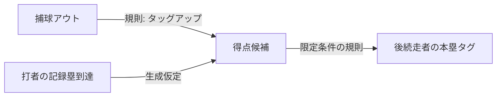

# 第10段階：生成順序・確率支持・858試合リーグ統合検証

主生成モードは **10,000試合すべて完走**。停止・基本記録整合性エラー・完走分の優先記録未確定はすべて0件でした。原本の終点に、明示した独立の順序生成モデルを組み合わせた実験結果です。原本の未知の時系列を復元できたという意味ではありません。

開始条件を満たしたため**12球団・各143試合・計858試合を全試合保存・再生して完走**しました。順位表・個人成績の再集計も一致しました。この限定された統合基盤を用いて、第11段階の選手能力・成長・衰退・故障へ進むことを推奨します。

成果：[ブランチ](https://github.com/kosuke213/baseball/tree/codex/stage10-season-stability) · [配布ZIP](https://raw.githubusercontent.com/kosuke213/baseball/refs/heads/codex/stage10-season-stability/data_sources/stage10/stage10_bundle.zip) · [サマリー](../../data_sources/stage10/summary.json) · [独立実行・モデルなし再生の検証](verification.json)

## 1. 実装と既存成果の保持

`baseball_simulation_lab/stability/`に新しい版を追加しました。第3〜9段階のソース・モデル・原本・加工データ・履歴・テスト・ZIPは変更していません。`completion.GameModel`、旧ルール、スコアブック、`Journal`の仕組み、`HistoryStore`の追記専用保存方式、`completion.season.Season`と`fullgame.league`の日程・順位表を再利用します。旧履歴は旧再生器で引き続き使えます。

- 得点・アウト・打者の塁到達・打席の決定を、根拠付き部分順序で表す`Event / Edge / Timeline`。
- 原本にない順序を独立のモデルで1回生成し、規則処理は抽選せず裁定する構造。生成器はスコア・回・表裏で有利な順序を選ばない。
- 合法な未観測終了への事後支持と、その終了を実行できる明示的な生成経路。
- 意味未定義の予備分類`other_pa`を退役した13分類。未知の入力は隔離し、アウトへ変換しない。
- 新版の不変な履歴・モデルなし再生・シーズン全選手合計・対応区分・回帰テスト。

## 2. 旧61サヨナラ＋other_paの再現と改善の内訳

旧62試合を同じ旧モデル・名簿・シード・継投設定で再実行し、失敗JSONと乱数状態まで全件一致しました。[62件の個別比較](../../data_sources/stage10/old62_comparison.json)には開始状態、選手ID、原本参照、旧プレー、足りない順序情報、新しく生成した順序と結果を保存しています。[原本の限定再確認](../../data_sources/stage10/source_case_review.json)に実ID・NP・177原列・出典指紋を残しました。新規プレーデータ取得は0件です。

| 判定 | 件数 | 意味 |
|---|---:|---|
| 元の順序を推測せず同一プレーを修復 | 0 | 原本だけでは依然、時刻を一意に確定できない |
| 同じ選択結果・終点に、明示的な生成順序を与えて処理可能 | 61 | 将来の架空プレーを生成するモデルとして対応。原本復元とは数えない |
| 元の実際の順序が未確定 | 61 | 情報不足は保持。全てを原本・規則だけで解消したとしない |
| other_pa | 1 | 予備ラベルに疑似件数が付いた問題。新版の分類集合を再設計 |

結果・進塁経路を失敗後に捨てて再抽選していません。各事例は固定した1回の順序生成です。新しい順序に従ってサヨナラ後のアウトを取り消し、元の予定GDPが成立しなければ限定条件の打点も再評価します。

第8段階の155停止は既存テストが旧版で全件厳密再現し、旧版を変更していないことも確認しています。第9段階以前の「同一プレー修正件数」と今回の「生成対応件数」を合算して原本の問題解消とは報告しません。

## 3. 根本変更：部分順序と生成仮定

入力配列や原本の記述順を時刻とみなしません。規則で確定する前後関係と、生成モデルの慣行を別ラベルで持ちます。例えば捕球→タッグアップ得点、先行走者の本塁到達→後続走者の通常本塁タグは限定条件下の規則です。一方、記録塁の到達を先に完了する、非第三アウトの予定GDPを得点より先に完了させる等は生成上の慣行です。



準備済みノードから一様に1個選んで順序を作ります。全てのトポロジカル順序へ一様とは限りません。時刻・球速・走速度・送球速度は生成していません。生成したアウト種別や順序を、原本で実測した値として経路表へ追加しません。

裁定はOBR 5.08(a)(b)、9.04、9.06等を参照。フォース／一塁到達前の第3アウトは同一プレーの得点を無効にし、先行・当該・後続走者のアピールを区別します。サヨナラ犠飛、非本塁打の安打価値の上限、本塁打全員得点、ゲーム終了後に数えないアウトを処理します。第4アウト・全てのアピールやランニング本塁打例外は未対応です。[規則とテストの対応](../../data_sources/stage10/rule_test_mapping.json)

原本経路の条件群別34,322件を、通常回とサヨナラ可能状況で計68,644件監査し、失敗0件でした。1経路・1状況に固定した1順序で、可能な全順序を尽くした証明ではありません。[経路監査](../../data_sources/stage10/route_support_audit.json)

## 4. 確率0・未観測合法プレーの評価

母集団は完了PA窓＋通常の未完了攻撃終了。未完了サヨナラ等の打ち切りは通常3アウトへ混ぜません。候補比較は2023年推定→2024年、参考評価は2023〜2024年推定→既知の2025年です。2025年は推定・候補選択へ使いません。

| 事前α=β | 2024 二項Log Loss | 2024 Brier | 2025参考 二項Log Loss | 2025 Brier |
|---|---:|---:|---:|---:|
| 0 | 0.01216088 | 0.0024219978 | ∞（観測1件に確率0） | 0.0024208568 |
| 0.1 | 0.01216349 | 0.0024219899 | 0.01220321 | 0.0024208560 |
| 0.5 | 0.01217451 | 0.0024219643 | 0.01220030 | 0.0024208544 |
| 1 | 0.01218931 | 0.0024219459 | 0.01220420 | 0.0024208560 |

**対数損失の改善を確認できなかったため、予測用の旧MLEモデルは維持しました。** Brierの微小な改善を精度向上の確証にはしません。生成モードでは別の目的で、Jeffreys Beta(0.5,0.5)の事後平均と95%事後区間を採用します。これは未観測事象への生成支持を与える実験的方針で、旧予測モデルを精度改善版に置換したものではありません。

通常の未完了攻撃終了は「開始走者数≧残り必要アウト数」の12状態だけが合法です。この構造マスクを平滑化より先に適用し、不可能な状態への質量は0。合法状態は正の事後確率を持ち、未観測の複数アウトは一意IDを保持した生成タグ経路で実行できます。事後区間は二項仮定下であり、全試合依存を含む保証ではありません。

`other_pa`は野球上の具体的な出来事を定義していなかった予備分類で、学習期間の実測は0。完了打席が13分類に網羅されていることを確認し、新版から予備分類を外して13分類へ比例再正規化しました。未知の新しい入力は隔離し、成功するアウトへ置き換えません。旧確率と分類は第9段階に保持しています。

[候補・全24状態の支持・正規化・分布差](../../data_sources/stage10/probability_evaluation.json)、[事後表・区間](../../data_sources/stage10/support_model.json)。2025年の既知の二重走塁死にも生成モードは正の支持を持ちますが、その原本を学習経路へ混入させていません。

## 5. 段階的な試合検証

主シード310000〜319999、原本限定410000〜410999。検証前に固定し、通るシードへの交換はありません。開発にも使う安定性検証で、未使用の予測評価ではありません。9回制・12回引分・自動走者なし・7回以降の機会に救援1人、架空開催日2026-04-01です。

| モード・累積試行 | 完走 | 停止 | 整合性エラー | 優先記録未確定（完走分） | 秒 |
|---|---:|---:|---:|---:|---:|
| 生成 100 | 100 | 0 | 0 | 0 | 4.86 |
| 生成 1,000 | 1,000 | 0 | 0 | 0 | 42.33 |
| 生成 10,000 | 10,000 | 0 | 0 | 0 | 404.25 |
| 原本限定 100 | 97 | 3 | 0 | 0 | 2.66 |
| 原本限定 1,000 | 979 | 21 | 0 | 0 | 24.21 |

主の半イニング完走率は100.000000%、速度約24.74試行/秒。全180,008半イニングのうち、3アウト終了179,120、サヨナラ終了888です。引分221試合。時間は共有Linux環境の実測で、原本監査と配布処理は別です。

原本限定の停止原因：`{"walkoff_out_timing_unknown": 14, "no_training_route:sacrifice_bunt": 1, "no_training_route:fielders_choice": 6}`。生成器を使わない場合に原本の情報不足が解消されたとはしません。主と対照はモデル方針・仮定・シードが違うので、単純な予測性能の優劣にしません。

全試行CSVと全停止JSON、チェックポイントを保存しています。主の100→1,000→10,000は累積で、計11,100種類という意味ではありません。ヘッドレスの全1万試合を公式履歴として保存したわけではなく、主10試合・対照2試合を完全保存して再生しています。

## 6. 858試合の統合検証

**858試合すべて終了、12球団すべて143試合、引分17試合**。勝利総数・敗戦総数はともに841、延べ球団試合数1716です。シード510001〜510858、日程順に一度だけ実行しました。全球団・全選手はリーグ平均で、能力差を作っていません。

| 順位 | 球団 | 試合 | 勝 | 敗 | 分 | 勝率 | 得点 | 失点 |
|---:|---|---:|---:|---:|---:|---:|---:|---:|
| 1 | T03 | 143 | 77 | 63 | 3 | 0.550 | 704 | 638 |
| 1 | T12 | 143 | 77 | 63 | 3 | 0.550 | 705 | 632 |
| 3 | T10 | 143 | 73 | 67 | 3 | 0.521 | 641 | 644 |
| 4 | T04 | 143 | 74 | 68 | 1 | 0.521 | 614 | 604 |
| 5 | T05 | 143 | 72 | 68 | 3 | 0.514 | 624 | 635 |
| 6 | T09 | 143 | 72 | 69 | 2 | 0.511 | 623 | 641 |
| 7 | T07 | 143 | 71 | 69 | 3 | 0.507 | 647 | 649 |
| 8 | T11 | 143 | 70 | 71 | 2 | 0.496 | 621 | 627 |
| 9 | T02 | 143 | 68 | 73 | 2 | 0.482 | 585 | 603 |
| 10 | T01 | 143 | 66 | 74 | 3 | 0.471 | 597 | 629 |
| 11 | T08 | 143 | 61 | 74 | 8 | 0.452 | 587 | 622 |
| 12 | T06 | 143 | 60 | 82 | 1 | 0.423 | 624 | 648 |

全試合で履歴を記録し、保存時と読込時に再生してスコア・全個人成績を照合。その再生結果から作った順位表・選手別合計が一致しました。チーム得失点、勝敗、引分両側、個人得点とスコア合計、重複排除、各143試合も検査しました。

[シーズン集計](../../data_sources/stage10/league/season.json) · [順位表CSV](../../data_sources/stage10/league/standings.csv) · [全選手成績CSV](../../data_sources/stage10/league/players.csv)。全858試合のSQLiteは配布ZIPの`league/history.sqlite3`に収録しています。

これは日程・保存・集計の統合試験です。固定先発・救援1名で毎試合を動かし、投手ローテーション・疲労・登録資格・能力差・成長・契約・球団経営は未実装です。本番のNPB型運営システムが完成したとはしません。順位規則も勝率→勝数→なお同率は同順位という実験規則です。

## 7. 分布とMLB参考比較

両球団合計の1試合あたり。MLB2025は既知の参考で、NPBの環境と同じではありません。

| 指標 | 生成平均 | 生成SD | MLB2025平均 | MLB2025 SD |
|---|---:|---:|---:|---:|
| 得点 | 8.741 | 4.166 | 8.895 | 4.594 |
| 安打 | 17.029 | 4.694 | 16.518 | 4.971 |
| 本塁打 | 2.361 | 1.560 | 2.325 | 1.712 |
| 四球 | 6.455 | 2.699 | 6.329 | 2.844 |
| 三振 | 17.394 | 3.733 | 16.726 | 4.120 |
| 打席 | 76.395 | 8.020 | 75.278 | 7.520 |

得点95%点は生成16／参考17、99%点20／22、最大29／33。延長率10.380%、サヨナラ率8.880%、引分率2.210%。10点差以上は2.410%、最大点差20です。

全分布・標準偏差・分位点・極端値をCSV/JSONへ保存しています。リーグ平均の選手だけで動かしているため分散の不足が残り、球場・守備・疲労・戦術・故障・成長も再現していません。平均が近いことを現実の再現精度の証明にはしません。タイブレーク・引分設定もMLBと異なります。

## 8. 記録・保存再生・テスト

打席・打数、安打・長打、四死球、三振、得点・打点、整数アウトによる投球回、被安打・失点、責任投手、限定した勝敗投手、イニング得点とチーム・個人の合計を検査します。原本の記録を使う部分と生成裁定を使う部分を区別し、全公式記録とはしません。自責点・セーブ・ホールド・裁量判定等はnull／要確認のままです。[機械可読対応表](../../data_sources/stage10/record_coverage.json)

**pytest 520件成功：既存388件を保持、新規132件。** 旧62件、旧155件、部分順序の制約・循環、原本逆フォースと犠飛DP、力学時刻を作らない裁定、第3アウト・アピール、四死球・安打価値・本塁打、全24状態の合法支持、確率正規化、Beta区間、固定シード、再生・改ざん・切断・旧版拒否、不変DB・シーズン重複拒否を確認しました。

履歴には試合ID・シーズンID・日程番号・名簿・日付・スコア・全成績・主要イベント・各版・シード・原本テンプレート・生成順序を保存します。終了後の再生はモデルを使いません。新しいNPB年度の確率を将来導入しても、過去試合は再抽選しません。旧DBの自動移行はせず、旧版とコピーを残す別工程です。

| 固定項目 | 値 |
|---|---|
| Snapshot | `75b7c55816cbb33e588c991c` |
| Model | `stability-model-1:ed6d5b54f6a6a061a326cde082da98372b93443c1a0296a4d15178d7be6021a6` |
| Engine / rules / history | `stability-engine-1` / `stability-rules-1` / `stability-history-1` |
| Python / SQLite | 3.12.14 / 3.53.1 |
| OS | Linux-6.18.55-x86_64-with-glibc2.41 |
| 親commit | `03a02714ab5779fd18d3fe5cdaad9a2f767dfec4` |

配布ZIPのCRC・全ファイルSHA256、独立した展開先での`python -S`起動、同一シードの完全履歴一致、推論ファイルを隠した状態での保存履歴再生を確認します。結果・実行コマンド・配布指紋は[verification.json](verification.json)、[bundle.json](../../data_sources/stage10/bundle.json)に保存します。Windows実機では未検証です。

```bash
.venv/bin/python -m baseball_simulation_lab.stability simulate --seed 310000 --db data/stability/history.sqlite3
.venv/bin/python -m baseball_simulation_lab.stability replay --db data/stability/history.sqlite3 --game-id YOUR_GAME_ID
.venv/bin/python -m baseball_simulation_lab.stability build
.venv/bin/python -m pytest -q
```

ZIPは`py -3 example.py --model-dir . --seed 310000 --db my_history.sqlite3 --journal my_game.jsonl`。原本限定は`--empirical-only`。[詳しい起動・再構築](../../data_sources/stage10/README.md)

## 9. 実測・規則・仮定・未達と移行判断

- **実測由来**：2023〜2024年の確率推定母集団・プレー終点・記録・選手の役割。2025年は参考監査のみ。球速・回転・打球角度を補完していません。
- **規則由来**：得点成立・第3アウトの例外、捕球後の得点、安打価値、限定した打点・投手責任等。NPB公式運用全体との同一性は認定しません。
- **生成仮定**：順序・不明アウト種別の限定モデル、未観測合法終了への事後事前分布とタグ経路、固定進塁、リーグ平均選手・固定投手運用。原本の実測時系列ではありません。
- **未達・残課題**：原本61件の実際の順序、生成順序の実測校正、全公式記録、全アピール・第4アウト、途中カウント・ロスター、未完了サヨナラの独立ハザード、NPB校正・能力差。
- **判断**：この実験規則における安定生成・履歴・シーズン集計は次段階へ接続できる水準です。全ルール無停止の保証はなく、既知の限界を保持したまま、能力・成長・衰退・故障へ進みます。際限のない物理モデルやCatBoost全面置換は優先しません。

[第11段階へのAPI・選手状態・歴史保存契約](../../data_sources/stage10/STAGE11.md)と[生成・規則の詳細](../../data_sources/stage10/TRANSITIONS.md)を引き継ぎます。
