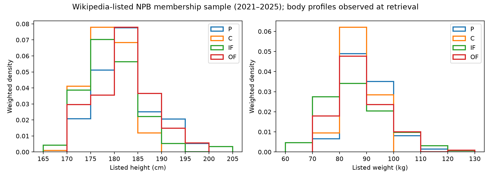
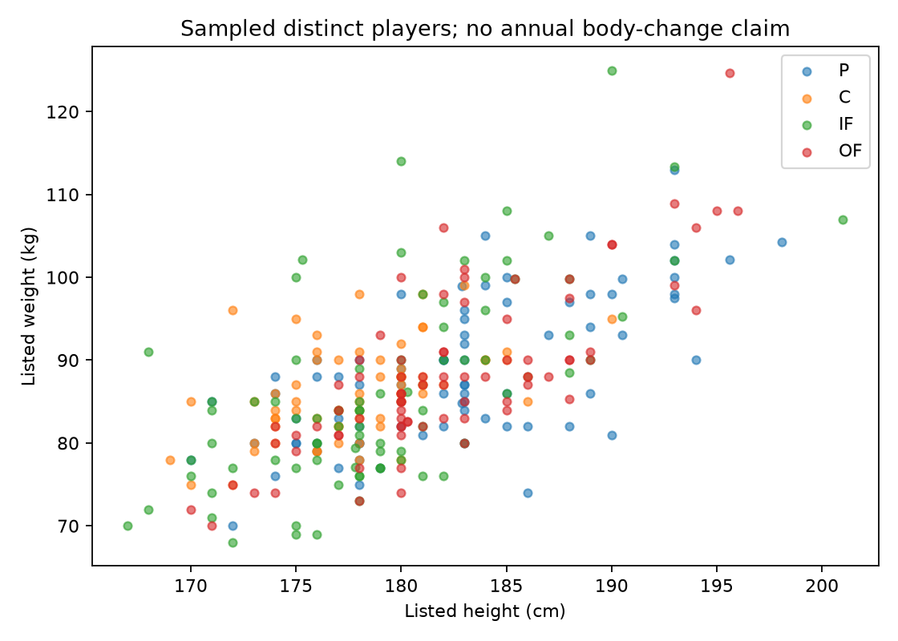

# 第11.5段階：NPB掲載選手標本に基づく身体・投打プロフィール

**新しい架空選手に、身長・体重・生年月日と、位置別の投打組み合わせを生成・保存できるようになりました。** 第3〜11段階のコード・モデル・記録・配布物・テストは変更していません。

ただし、**公式NPB全選手・全年度の実測校正は未達**です。公式サイトの二次利用制限を確認し、再利用条件を確認できるWikipedia年度記事とプロフィールの標本へ範囲を変更しました。年度の在籍欄と、取得時点の身体掲載値を結合した参考校正です。

[作業ブランチ](https://github.com/kosuke213/baseball/tree/codex/stage11-5-npb-profiles) · [架空720人CSV](https://raw.githubusercontent.com/kosuke213/baseball/refs/heads/codex/stage11-5-npb-profiles/data_sources/stage11_5/fictional_players.csv) · [集計CSV](../../data_sources/stage11_5/body_statistics.csv) · [生成パラメータ](../../data_sources/stage11_5/parameters.json)

## 1. 取得した範囲・分母

2021〜2025年の5年・12球団、60球団年度記事を確認し、**59記事の選手欄を解析**しました。2024年ソフトバンクの記事には選手欄がなく、同年は11球団です。原本の構造が欠けており、推測で選手を埋めていません。

掲載枠は重複統合後**4,948選手年度・1,642記事ID**。固定した層化抽出により**364人のプロフィール**を取得し、主名簿は**310人・948選手年度**、育成は**117人・216選手年度**を集計しました。複数年の区分移行があるため、主名簿人数と育成人数は加算できません。

| 名簿年 | 記事の球団数 | 主名簿の掲載選手年度 | 主名簿のプロフィール標本 | 育成の掲載選手年度 | 育成の標本 |
|---|---:|---:|---:|---:|---:|
| 2021 | 12 | 854 | 203 | 91 | 18 |
| 2022 | 12 | 836 | 193 | 158 | 48 |
| 2023 | 12 | 823 | 182 | 202 | 53 |
| 2024 | 11 | 761 | 176 | 166 | 42 |
| 2025 | 12 | 836 | 194 | 221 | 55 |

同じ選手が複数年在籍すれば複数の選手年度ですが、**身体を毎年測った件数ではありません**。年度内の複数球団掲載は39選手年度あり、リーグ全体では1回、球団別の掲載範囲では各球団に数えます。原本の主名簿・育成欄を使い、同年に両方なら主名簿を優先。公式の年度末名簿や公示履歴の完全復元ではありません。

今回の抽出364人では身長・体重・生年月日・投打の欠測は0件。国籍欄には欠測や亡命の注記だけの例があり、不明として分離しました。名簿の未抽出者は欠測0に含めません。全名簿に身体欄を付けたとはしていません。位置競合等による隔離は0選手年度です。

各球団×主位置の5年の和集合から主名簿6人・育成2人を固定抽出し、逆抽出確率で重み付けしました。同じ人が複数の枠で抽出される確率も合成しています。以下の平均・比率は**掲載枠に対する標本の重み付き推計**で、公式全数の割合ではありません。欠測者の引き直しや良いシードの選別はありません。

[球団別CSV](../../data_sources/stage11_5/coverage.csv) · [出典・条件](../../data_sources/stage11_5/RIGHTS.md) · [集計ごとの出典対応](../../data_sources/stage11_5/aggregate_provenance.json) · [取得URL・日時・SHA256](../../data_sources/stage11_5/sources.json)

## 2. 身長・体重・年齢

主名簿の選手年度標本。身長・体重は取得時点の掲載値で、年齢だけを各年7月1日に合わせます。身長・体重と年齢の関連には測定時点のずれがあり、加齢による変化とは解釈しません。

| 項目 | 平均 | 中央値 | 標準偏差 | 最小–最大 | 5% | 25% | 75% | 95% |
|---|---:|---:|---:|---|---:|---:|---:|---:|
| 身長cm | 180.78 | 180.0 | 6.09 | 167.0–201.0 | 171.0 | 176.0 | 184.0 | 193.0 |
| 体重kg | 87.64 | 87.0 | 9.06 | 68.0–125.0 | 74.0 | 82.0 | 92.0 | 104.3 |
| 満年齢 | 26.47 | 26.0 | 4.66 | 16–40 | 19.0 | 23.0 | 30.0 | 34.0 |

身長と体重のPearson相関は**0.701**、Spearmanは0.689。年齢を線形に除いた残差の相関は0.699でした。これは関連の記述で、体格が能力を生む因果係数ではありません。極値は原本の単位欄と照合し、削除せず[監査](../../data_sources/stage11_5/quality.json)に残しました。

| 区分 | 標本の異人数 | 身長平均cm | 体重平均kg | 身長×体重の相関 |
|---|---:|---:|---:|---:|
| 投手 | 81 | 181.88 | 88.98 | 0.696 |
| 捕手 | 72 | 178.04 | 86.58 | 0.449 |
| 内野手 | 84 | 179.02 | 85.72 | 0.681 |
| 外野手 | 81 | 181.40 | 86.85 | 0.820 |
| 育成（別集団） | 117 | 180.41 | 82.62 | 0.698 |

位置別の異人数は、年度をまたいで位置が変わった選手を複数の位置で数えるため、合計して全体人数とはしません。

図の点は氏名を表示しない標本。ヒストグラムは重み付き、散布図は同一人を一度だけ表示します。[年度別・年齢別・身長帯別の統計](../../data_sources/stage11_5/statistics.json)には分位点・体重分布・相関を含めています。

## 3. 投げる手と打席の組み合わせ

右投げ**82.47%**・左投げ**17.53%**。右打ち**59.73%**・左打ち**38.10%**・両打ち**2.18%**でした。投げる手と打席は別変数で、独立に抽選していません。

| 投打 | 観測した選手年度数 | 重み付き比率 |
|---|---:|---:|
| 右投右打 | 572 | 59.533% |
| 右投左打 | 267 | 21.454% |
| 右投両打 | 11 | 1.488% |
| 左投左打 | 95 | 16.642% |
| 左投右打 | 1 | 0.192% |
| 左投両打 | 2 | 0.691% |

観測件数は反復在籍年を含み、希少な組み合わせの独立人数ではありません。投手／野手、位置、年度、国籍欄の区分ごとの表は[handedness.csv](../../data_sources/stage11_5/handedness.csv)。未知表記を右へ変換せず、0観測も構造的な禁止とはしません。平滑化は個人単位の有効件数を用い、位置ごとの違いを保つ階層の事前量を設定しています。

左投右打は1人、左投両打は1人由来で、特に割合が不安定です。標本の重み付き比率をNPB全体の確定値や正確な希少率とは扱いません。

国籍欄が日本の群、日本以外の群、複数、不明を別集計しました。出身地・氏名から国籍を補わず、亡命先を国籍と断定していません。これらをNPBの外国人登録資格と同一視せず、国籍の過去時点変化も復元していません。

## 4. 新しい生成器と分布の検証

主位置→参照群→6通りの投打→身長・体重・年齢の共同度数セル→暦に整合する生年月日→第11段階の能力との接続、という順です。身体は単一の正規分布に押し込まず、国籍欄の群や位置の少数例は出典キー付きでプールします。身体・投打用の乱数は才能・試合・成長・故障から分離しています。

最初の身長5cm・体重10kg区分では、身長×体重の相関が弱まりました。同じ20シード・各720人で区分を比較し、2.5cm・5kgを採用しました。シードは選び直していません。細かいセルは少数例・過適合の不確実性が増えるため、その限界も残します。これは校正データを使った方法選択で、独立検証ではありません。

| 区分（身長／体重） | 生成人数 | 相関 | 校正対象との差 |
|---|---:|---:|---:|
| 5cm / 10kg | 14,400 | 0.607 | 0.109 |
| 2.5cm / 5kg | 14,400 | 0.681 | 0.035 |

最終版は**14,400人**。位置構成は全掲載枠の比率を使い、体格は抽出標本を使うため、比較対象も位置で再重み付けしています。これは公式全数への一致ではなく、採用した校正標本への再現性確認です。

| 項目 | 校正対象 | 最終生成 |
|---|---:|---:|
| 平均身長cm | 180.731 | 180.670 |
| 平均体重kg | 87.730 | 87.525 |
| 平均年齢 | 26.431 | 26.505 |
| 身長×体重の相関 | 0.716 | 0.681 |

標準偏差の最大相対誤差は1.69%、6通りの投打の総変動距離は0.0079、位置比率は0.0099。事前設定した7条件は7/7を満たしました。極端な値を消したり、試合結果を後から合わせたりしていません。

2025年の主名簿標本194選手年度を別集計し、そのうち名簿年2021〜2024の学習に同一人がいないのは33人です。ただし身体の取得日は後日で、抽出枠にも5年を使っており、未使用の時系列テストとは称しません。初掲載を新人とも呼びません。

[20シード別の平均・ばらつき](../../data_sources/stage11_5/generation_by_seed.csv) · [分位点・位置別比較・2025参考](../../data_sources/stage11_5/generation_validation.json) · [方法比較](../../data_sources/stage11_5/method_comparison.json)

## 5. 能力・左右相性・体重の扱い

**身体から能力への新しい補正は0、左右相性への新しい補正も0です。** 体格と位置・年齢の横断的関連までは集計しましたが、出場機会を調整した身体×成績やNPB左右対戦の信頼できる母集団は取得できていません。名鑑の投打割合を対戦有利率に置き換えていません。両打ちはSで保存し、相性が無効なモードでは新たな打席側選択ルールを導入しません。

身体は別の追加専用DBに保存し、元のキャリアの内部能力・才能と分離しました。身長と基準体重は固定し、体重変更は日付・理由・版付きの明示イベントで記録します。年次のランダム増減は無効。変更のない年に架空の年次測定値を追加しません。過去日は当時の体重を返し、未来日は拒否します。

新しい世界で初期能力・健康・才能は従来の抽選を利用します。身体による上乗せはなく、新しい生年月日を将来の年齢更新に使います。第11段階の初期能力の年齢仮定自体をNPBへ再校正したものではありません。

## 6. 互換性・テスト・保存再生

**全593件成功（既存567件をそのまま保持、新規26件）。** 身体値・暦・投打、選手年度の重複・昇格・移籍・位置競合、取得制限・429停止、乱数独立、未来・内部情報の拒否、保存・体重変更・改ざん検知を検証しました。

新しい720人を生成し、固定初期ロスターの**100試合中100試合完走**。停止0、成績整合性エラー0、優先記録未確定0。全試合の保存再生、新プロフィール・状態・体重の復元、過去日の体重不変を確認しました。この100試合は負荷を蓄積するシーズン試験ではありません。

旧第11段階の**720人・1,716試合・2シーズン**を再生し、順位表と個人成績が一致。元DBのSHA256も前後一致し、元スナップショットの全ファイル指紋を検証しました。旧選手へ身長・体重を自動追加していません。確率モデルを読み込んで過去を再抽選する処理はありません。

[互換性試験](../../data_sources/stage11_5/compatibility.json) · [旧履歴の検証](../../data_sources/stage11_5/legacy_replay.json) · [最終検証・指紋](../../data_sources/stage11_5/verification.json)

## 7. 完了条件と次段階

| 条件 | 判定 |
|---|---|
| 年度・球団の範囲、重複、欠測を明記 | 達成（59/60球団年度、標本の限界付き） |
| NPB公式の5年全数・同時点身体分布 | 未達（利用条件と原典・時点の不足） |
| 掲載標本に基づく身体・投打の新生成器 | 達成（実験用の参考校正） |
| 身長・体重・年齢の共同抽選、投打同時抽選 | 達成 |
| 既存567テストと旧履歴の保持 | 達成 |
| 新プロフィールの保存・公開・体重履歴 | 達成（キャリアDBとの横断的原子保存は未実装） |
| 実測の体格×能力、NPB左右対戦補正 | 未達・無効 |
| 新人の経路別の実測分布 | 未達。在籍者分布の自動流用を禁止 |

第12段階の**実験用の有限候補・球団編成へは接続可能**です。ただし新人の実測校正版としては完成していません。確認できる入団日・高校／大学／社会人・海外等の経路を持つ母集団を優先し、NPB公式データの適切な利用条件の確保も継続します。

新人の暫定生成は、年齢を指定し`acknowledge_stock_proxy=True`を明示した場合だけ在籍者の年齢条件付き代理を許し、`stock_age_conditioned_proxy`として保存します。観測した年齢セルがなければ停止します。正式な新人分布と同一視しません。

[再現コマンド・デモ](../../data_sources/stage11_5/README.md) · [方法と境界](../../data_sources/stage11_5/MODEL.md) · [第12段階へのAPI](../../data_sources/stage11_5/STAGE12.md)
