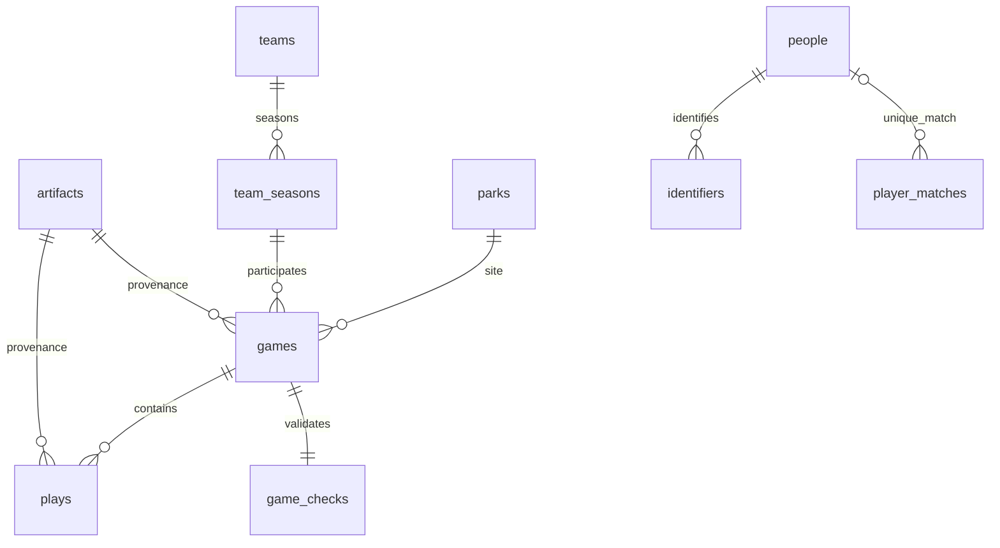

# 共通DBと収集処理の構成

[結果](README.md) / [データの開き方](../../data_sources/warehouse/README.md)

## 実装

| ファイル | 担当 |
|---|---|
| [warehouse_schema.sql](../../data_collection/warehouse_schema.sql) | 型・主キー・外部キー・範囲制約・分析用ビュー |
| [warehouse_store.py](../../data_collection/warehouse_store.py) | 年ごとのストリーム変換、ID表、出典・単位、全試合検査 |
| [warehouse.py](../../data_collection/warehouse.py) | 計画とlockの確認、実行台帳、排他制御、不変版の作成と現行版の切替、配布ZIP |
| [warehouse_updates.py](../../data_collection/warehouse_updates.py) | ETag等による条件付き更新確認。変更候補を別に保存し、現行版へ自動昇格させない |
| [fetch.py](../../data_collection/fetch.py) | 第2段階と共用するサイズ上限・TLS検証付き原本取得とSHA256検査 |
| [data-warehouse.yml](../../.github/workflows/data-warehouse.yml) | 手動／週次処理とGitHub Actions成果物保存の設定 |

Python 3.11以上の標準ライブラリ、SQLite、ZIP、CSV、SHA256を使用します。既存のNumPy・pandas・Streamlit・pytestを変更せず、追加の契約・APIキー・DBサーバーを必要としません。取得条件が未確認のライブラリを使った一括取得へ切り替えていません。

## 保存先と版

- `data/research/pilot/raw`：既存の原本ストアを共有。SHA256名の原本は不変。第2段階の固定計画も再実行可能。
- `data/research/warehouse/ledger.sqlite3`：開始・終了・中断・失敗・再利用の実行履歴、ファイルごとの取得・キャッシュ・失敗。
- `data/research/warehouse/run.lock.sqlite3`：OS/SQLiteが解放する排他ロック。強制終了後に手動のロックファイル削除を必要としない。
- `data/research/warehouse/snapshots/<id>`：DB、品質、取得情報、利用条件、計画、lockとファイル指紋。旧版を保持。
- `data/research/warehouse/current.json`：現行版のIDとDBのSHA256。完成版を検査した後に原子的に置換。
- `data_sources/warehouse`：閲覧用の結果・CSV・配布ZIP。全件のDBはZIPに含み、原本一式は含まない。

スナップショットIDは、計画・lock・変換コードとSQL・Python/SQLite版・規則の適用範囲を基に決定します。取得元GitHubのコミットは完全なSHAで固定し、可変URLも取得バイト列のSHA256を固定します。規則の出典と測定・集計の定義資料を保持し、年の違いを列名だけで同一視しません。

変換中は一時ディレクトリに新しいDBを作成し、SQLite整合性・参照・データ検査後に不変版へ移します。配布物が完成してから現行版を切り替えます。過去の版を消さず、同じ版の処理は再利用できます。SIGKILL等で中断された実行は、次回の排他ロック取得後にinterruptedへ記録されます。取得済み原本から再開し、構築途中のDBを現行版として読みません。

## 表と参照



`plays`の投打者・走者は原Retrosheet IDを保持し、`player_matches`の一意な対応を介して人物へ結びます。未対応・複数候補を氏名で解消しません。`analysis_plays`は試合検査合格かつfull PBPだけを対象とし、人物の対応状態も列に出します。

`game_team_stats`はGame Logs由来の成績、`game_checks`はプレーからの再集計との照合です。`excluded_game_groups`はオールスター・ポストシーズン等の対象外と理由を保持します。行番号はCSVの論理レコード番号で、ヘッダーがある表はヘッダーを1行目として数えます。

原本をたどる例：

```bash
python -m data_collection.warehouse source-row --game-id SDN202403200 --play 1
```

このコマンドは現行DBの出典行から元ZIPを選び、SHA256を検査して全177列を返します。原本キャッシュがなければ、固定計画の `run` で復元します。可変URLの原本が上流で更新されて指紋が変わった場合は停止し、以前の版を上書きしません。

気象は`weather_observations`の1行が1項目・1時刻です。数値、カテゴリ、空欄、記号付き表記を分けます。カテゴリの風向や記号を0へ変換しません。日本のボードは`secondary_claims`に原注記ごと保存し、外部人物IDはNULLです。

## 更新確認と運用範囲

固定コミットの20項目は再ダウンロードせず、可変URLをIf-None-Match等で確認します。ChadwickとJapan Prospect LabはGitの既存HTTPS認証経路でリモートHEADも確認し、新しいコミットの候補を検知します。Gitがない場合・確認に失敗した場合は未完を表示します。新コミットは必ずしもデータ更新を意味せず、固定原本の上書きには使いません。HTTP 304と、実バイト列を読んだ同一SHA256を区別します。変更された本体や条件資料は`update_candidates/<実行ID>`へ別に記録し、固定lockを更新しません。403等は失敗、429は同じホストへの後続確認を停止。失敗・途中受信も転送量に計上します。

ネットワーク取得は実行あたり140 MBまで、ファイルごとの上限も適用。今回の原本は約92 MBです。ZIPはディスクに展開せず、所定メンバーの非圧縮上限160 MBを適用します。全年度の一括メモリー展開を避け、年別ZIPをCSVレコードで走査し、試合単位で検査・挿入します。

週次設定は月曜04:17 UTC。GitHub既定ブランチへの反映・有効化が必要です。成果物の保存期間は14日、固定原本のキャッシュは利用可能性を保証する永久保管ではありません。クラウドを閉じた後もこの作業ブランチが自動で収集し続けるとは扱いません。公開したZIP・取得情報と不変スナップショットで版を追える設計にしています。
